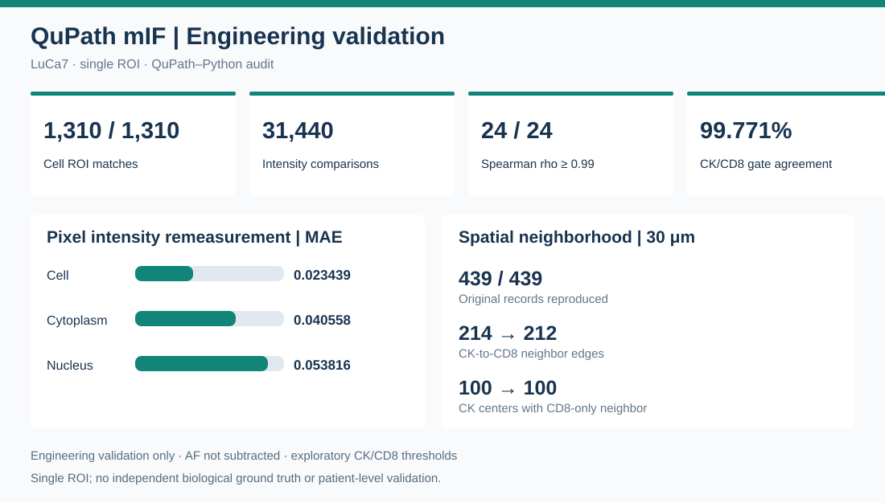
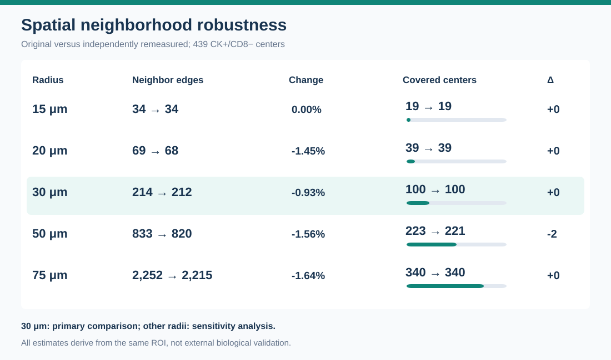

# QuPath mIF Cell Quantification & Spatial Analysis

**Engineering Reproducibility v1.0** · QuPath 0.7 + Python · Research demonstration

A reproducibility-oriented workflow for multiplex immunofluorescence (mIF)
cell measurements, patch-level pixel intensity audits, exploratory phenotyping,
and centroid-distance spatial neighborhood analysis.

## Main results at a glance



**Figure 1.** Engineering audit of one LuCa7 ROI. The 31,440 intensity values were independently remeasured from exported polygon ROIs; they are not pixel-exact recoveries of original QuPath segmentation-label values. CK/CD8 gating thresholds are exploratory and biologically unvalidated.



**Figure 2.** Original versus independently remeasured neighborhood results across 15–75 μm. At the primary 30 μm radius, edges changed from 214 to 212, while covered CK+/CD8− centers remained 100. All results are from the same ROI and do not establish clinical or cross-patient generalization.

## Verified engineering results (one LuCa7 ROI)

| Check | Result |
| --- | --- |
| Original cell / ROI matching | 1,310 / 1,310 unique matches |
| Independent ROI-based mean-intensity comparisons | 31,440 values |
| Marker-compartment rank correlation | Spearman rho >= 0.99 in 24 / 24 combinations |
| Exploratory CK/CD8 gating agreement | 1,307 / 1,310 (99.771%) |
| Original 30 um neighborhood calculations | 439 / 439 records reproduced |
| CK-to-CD8 edges after independent remeasurement | 214 vs. 212 |
| CK-only cells with any CD8-only neighbor within 30 um | 100 / 439 with both methods |
| Source freeze | 19 scripts verified, zero SHA-256 mismatches |

## Workflow

1. QuPath 0.7 fluorescence measurements and cell segmentation.
2. Marker distributions, provenance and autofluorescence (AF) QC.
3. Exploratory CK/CD8 phenotyping and cell-centroid spatial analysis
   (single ROI in this demonstration).
4. Independent ROI-based pixel intensity remeasurement (Nucleus / Cell /
   Cytoplasm) and marker-wise error evaluation.
5. Sensitivity of fixed exploratory gates and spatial neighborhoods.
6. Integrity checks and blinded visual-review preparation.

Source scripts are under [`src/`](src/). Original raw microscopy files,
QuPath project databases, per-cell measurements, geometries, clinical data and
review images are intentionally **not included**.

## Data required for local reproduction

Use **your own authorized multichannel mIF image, QuPath cell objects, and
measurement exports**. Scripts depend on the original project folder layout;
review file paths and parameter settings before execution. The reported metrics
are from the original local validation and are not reproduced by cloning this
code-only repository. See `requirements.txt` for commonly used Python packages;
QuPath 0.7 is a separate prerequisite.

## Limitations

- Saved polygon ROI remeasurements are **not** numerically identical to
  measurements on the original segmentation-label pixels; original labels
  were not released.
- Autofluorescence was flagged/audited, **not subtracted**.
- CK >= 3.5 and CD8 >= 0.5 were **exploratory, unvalidated** thresholds.
- Biological positivity, sensitivity/specificity, independent clinical
  outcome prediction, and cross-patient generalization were **not validated**.
- A 100-cell blinded-review package was prepared locally but human annotation
  remains pending.

## Data and research ethics

This repository is **code-only**. Do not commit raw images, QuPath data files,
ROI geometry, patient identifiers, local review keys or individual cell tables
without data rights, appropriate permissions and de-identification review.

## Status

Engineering workflow frozen as **v1.0 (2026-10-30)**. Biological validation
remains future work.

## Groovy Script Configuration

The QuPath Groovy scripts use the environment variable
`QUPATH_MIF_ROOT` to locate the local project directory.

Example on Linux:

```bash
export QUPATH_MIF_ROOT="/path/to/your/QuPath-mIF-project"
Launch QuPath from an environment where this variable is set.
Otherwise, the exporter scripts will raise an explanatory error.

The original microscopy data and QuPath project files are
not distributed in this repository.EOF

